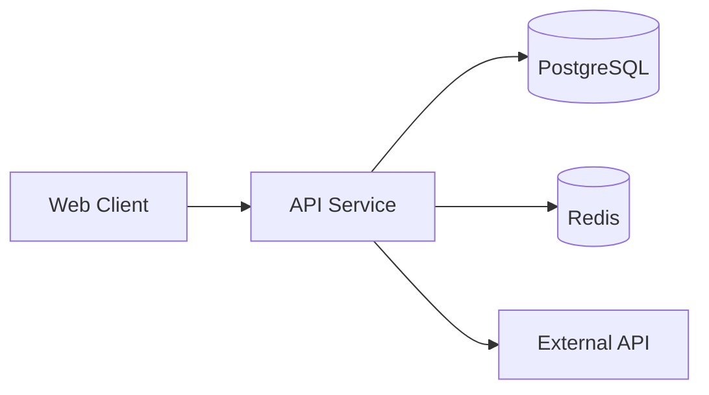

# Project Name

> One sentence: what problem this solves and for whom.


**Live demo:** [link] · **Video walkthrough:** [link] · **API docs:** [link]

<!-- Add a GIF or screenshot here. Recruiters look at this first. -->


## The Problem
2–4 sentences. Who has this problem, why it matters, why existing solutions fall short.
If it's an Indonesia-specific problem, add one sentence of context for international readers.

## Features
- **Feature one:** short description
- **Feature two:** short description
- **Feature three:** short description

## Architecture

Key design decisions are recorded in [`docs/adr/`](docs/adr/).

## Tech Stack
| Layer | Choice | Why |
|---|---|---|
| Backend | e.g. Spring Boot | reason |
| Database | e.g. PostgreSQL | reason |
| Infra | e.g. Docker, Kubernetes | reason |

## Getting Started

### Prerequisites
- Docker & Docker Compose
- (Java 21 / Node 22 for local development without Docker)

### Run locally
```bash
git clone https://github.com/OWNER/REPO.git
cd REPO
cp .env.example .env
docker compose up
```
Then open `http://localhost:8080`. Demo account: `demo@example.com` (seeded automatically).

## Running Tests
```bash
./mvnw verify      # Java
npm test           # TypeScript
```
What the tests cover: unit tests for business logic, integration tests against a real database, and [special cases, e.g. concurrency tests].

## Results
| Metric | Value | How it was measured |
|---|---|---|
| e.g. p95 latency | X ms at Y RPS | k6 load test, see `load-tests/` |

## Design Decisions & Trade-offs
- **Decision:** why, and what was traded off. See [ADR-0001](docs/adr/0001-record-architecture-decisions.md).

## How I Used AI
Honest, short: what AI helped with (e.g. boilerplate, CI config, test scaffolding) and what I designed and wrote myself (e.g. core domain logic, concurrency handling, architecture).

## What I Learned
- Lesson one
- Lesson two

## Roadmap
- [ ] Planned feature
- [ ] Planned improvement

## Data Sources & Attribution
- e.g. Weather data: BMKG (Badan Meteorologi, Klimatologi, dan Geofisika). This project is not affiliated with BMKG.

## License
[MIT](LICENSE)
