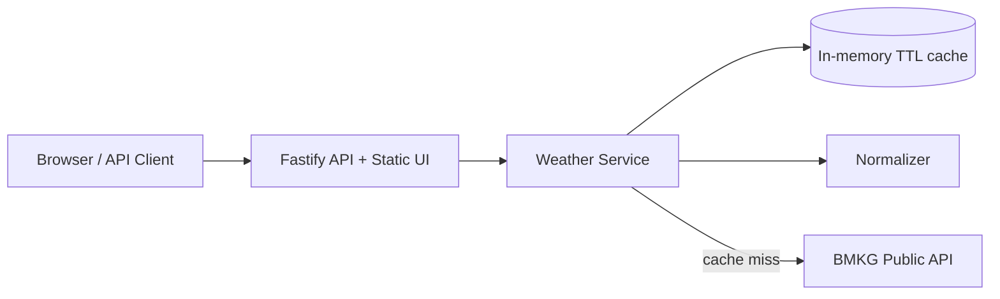

# BMKG Weather Aggregator

> REST API dan web sederhana yang mengubah prakiraan cuaca publik BMKG menjadi data yang rapi, cepat, dan mudah dipakai.


**Live demo:** belum dideploy · **API docs:** [`docs/architecture/api-spec.md`](docs/architecture/api-spec.md) · **Design spec:** [`docs/product/design-spec.md`](docs/product/design-spec.md)

> Status: dokumentasi selesai; implementasi kode menyusul.

## Masalah

API BMKG menyediakan data yang kaya, tetapi berbentuk mentah dan bertingkat, hanya bisa diakses lewat kode wilayah `adm4`, tidak punya cache, dan bisa lambat atau gagal. Aplikasi yang memanggilnya langsung ikut rapuh, sementara pengguna awam tidak ingin menghafal kode seperti `31.71.03.1001`.

Proyek ini menyediakan lapisan kecil di atas API tersebut: katalog kota yang ramah pengguna, respons yang sudah dinormalisasi, cache TTL, single-flight, dan error yang konsisten.

## Fitur

- **Katalog kota terverifikasi:** 15 kota dengan `adm4` yang sudah diuji ke API BMKG.
- **Dua cara query:** berdasarkan slug kota atau kode wilayah.
- **Normalisasi data:** flatten struktur bertingkat, urut waktu, buang duplikat.
- **Cache TTL + single-flight:** mengurangi beban upstream dan mencegah stampede.
- **Ketahanan upstream:** timeout, retry terbatas, error terstruktur.
- **UI satu halaman:** pilih kota, lihat kartu prakiraan, tanpa build frontend.
- **Kontrak API terdokumentasi:** contoh request/response dan kode error stabil.

## Arsitektur



Keputusan penting dicatat di [`docs/architecture/adr/`](docs/architecture/adr/). Ringkasan arsitektur: [`docs/architecture/architecture.md`](docs/architecture/architecture.md).

## Tech Stack

| Layer | Pilihan | Alasan |
|---|---|---|
| Runtime | Node.js 24 LTS | Dukungan jangka panjang, `fetch` bawaan |
| Bahasa | TypeScript 5.9.3 | Type safety; kompatibel dengan tooling lint |
| HTTP | Fastify 5 | Cepat, schema-first, mudah diuji |
| Validasi | zod 4 | Validasi env dan query |
| UI | HTML/CSS/JS statis | Tanpa build step |
| Test | Vitest 5 | Cepat, ESM native |
| Lint/format | ESLint 10 + Prettier 3.9 | Konsistensi |

## Menjalankan lokal

Prasyarat: Node.js 24 LTS dan npm 11.

```bash
nvm use 24
npm ci
cp .env.example .env
npm run dev
```

Buka `http://localhost:8080`.

```bash
curl http://localhost:8080/health
curl "http://localhost:8080/api/weather?city=bandung"
curl "http://localhost:8080/api/weather?adm4=31.71.03.1001"
```

## API

| Method | Path | Deskripsi |
|---|---|---|
| GET | `/health` | Status proses |
| GET | `/api/cities` | Daftar kota |
| GET | `/api/weather?city=<slug>` | Prakiraan berdasarkan kota |
| GET | `/api/weather?adm4=<kode>` | Prakiraan berdasarkan kode wilayah |
| GET | `/` | Web UI |

Contoh respons:

```json
{
  "data": {
    "location": {
      "adm4": "31.71.03.1001",
      "province": "DKI Jakarta",
      "city": "Kota Adm. Jakarta Pusat",
      "district": "Kemayoran",
      "village": "Kemayoran",
      "latitude": -6.1647214778,
      "longitude": 106.8453837867,
      "timezone": "Asia/Jakarta"
    },
    "forecasts": [
      {
        "datetimeUtc": "2026-10-26T08:00:00.000Z",
        "datetimeLocal": "2026-10-26T15:00:00+07:00",
        "temperatureC": 30,
        "humidityPct": 67,
        "precipitationMm": 1.2,
        "cloudCoverPct": 100,
        "weatherId": 61,
        "descriptionId": "Hujan Ringan",
        "descriptionEn": "Light Rain",
        "windSpeedKmh": 9,
        "windDirection": "W",
        "windDirectionTo": "E",
        "windDegree": 310,
        "iconUrl": "https://api-apps.bmkg.go.id/storage/icon/cuaca/hujan ringan-am.svg"
      }
    ]
  },
  "meta": {
    "cached": false,
    "fetchedAt": "2026-10-26T07:55:00.000Z",
    "source": "BMKG",
    "requestId": "req-7"
  }
}
```

Kontrak lengkap: [`docs/architecture/api-spec.md`](docs/architecture/api-spec.md).

## Menjalankan test

```bash
npm test
npm run test:coverage
npm run lint
npm run typecheck
npm run build
```

Test tidak memanggil jaringan. Smoke test live opsional:

```bash
LIVE_BMKG=1 npm test -- tests/live
```

Strategi test: [`docs/analysis/testing-strategy.md`](docs/analysis/testing-strategy.md).

## Struktur proyek

```
src/
  app.ts, server.ts, config.ts, errors.ts, logger.ts
  cache/    clients/    data/    routes/    schemas/    services/
public/
tests/
docs/
  analysis/       testing strategy, quality checklist
  architecture/   overview, modules, workflows, API, data model, ADR
  changelog/      CHANGELOG
  operations/     runbook operasional
  product/        PRD, business rules, roadmap, design spec
  prompts/        catatan prompt AI
```

## Design Decisions & Trade-offs

- **Fastify + TypeScript** alih-alih Express/NestJS: ringan, schema-first, mudah diuji. Lihat [ADR-0002](docs/architecture/adr/0002-use-fastify-and-typescript.md).
- **Cache in-memory + single-flight** alih-alih Redis: cukup untuk satu instance, tanpa infrastruktur. Lihat [ADR-0003](docs/architecture/adr/0003-in-memory-cache-and-single-flight.md).
- **UI statis** alih-alih React/Next: fokus pada backend, tanpa build frontend. Lihat [ADR-0004](docs/architecture/adr/0004-vanilla-static-ui.md).
- **Katalog `adm4` terkurasi** alih-alih pencarian wilayah: kejujuran data di atas cakupan luas. Lihat [ADR-0005](docs/architecture/adr/0005-curated-adm4-catalog.md).

## Dokumentasi

Indeks lengkap: [`docs/README.md`](docs/README.md).

| Kategori | Dokumen |
|---|---|
| Product | [PRD](docs/product/prd.md) · [Business rules](docs/product/business-rules.md) · [Roadmap](docs/product/roadmap.md) · [Design spec](docs/product/design-spec.md) |
| Architecture | [Overview](docs/architecture/architecture.md) · [Modules](docs/architecture/modules.md) · [Workflows](docs/architecture/workflows.md) · [API spec](docs/architecture/api-spec.md) · [Data model](docs/architecture/data-model.md) · [ADR](docs/architecture/adr/) |
| Analysis | [Testing strategy](docs/analysis/testing-strategy.md) · [Quality checklist](docs/analysis/quality-checklist.md) |
| Operations | [Operations](docs/operations/operations.md) |
| Changelog | [CHANGELOG](docs/changelog/CHANGELOG.md) |
| Prompts | [Prompt log](docs/prompts/README.md) |

## How I Used AI

AI membantu scaffolding proyek, penulisan dokumentasi awal, konfigurasi lint/test, dan penyusunan CI. Keputusan arsitektur, kontrak API, aturan bisnis, dan setiap baris kode ditinjau serta dipertanggungjawabkan oleh penulis. Catatan prompt disimpan di [`docs/prompts/`](docs/prompts/).

## What I Learned

- Merancang kontrak error yang stabil lebih penting daripada menambah fitur.
- Cache bukan sekadar kecepatan; ia juga perlindungan terhadap upstream.
- Single-flight mencegah masalah yang tidak terlihat sampai ada beban paralel.
- Dokumentasi aturan sebelum kode mengurangi ambiguitas implementasi.

## Roadmap

Lihat [`docs/product/roadmap.md`](docs/product/roadmap.md). Tahap berikutnya: Dockerfile + Compose, rate limiting, lalu deploy demo.

## Data Sources & Attribution

- Sumber data: BMKG (Badan Meteorologi, Klimatologi, dan Geofisika), API publik `https://api.bmkg.go.id`.
- Proyek ini **tidak berafiliasi** dengan BMKG dan bukan layanan resmi.
- Hanya data publik; tidak ada data pribadi yang disimpan.

## License

[MIT](LICENSE)
