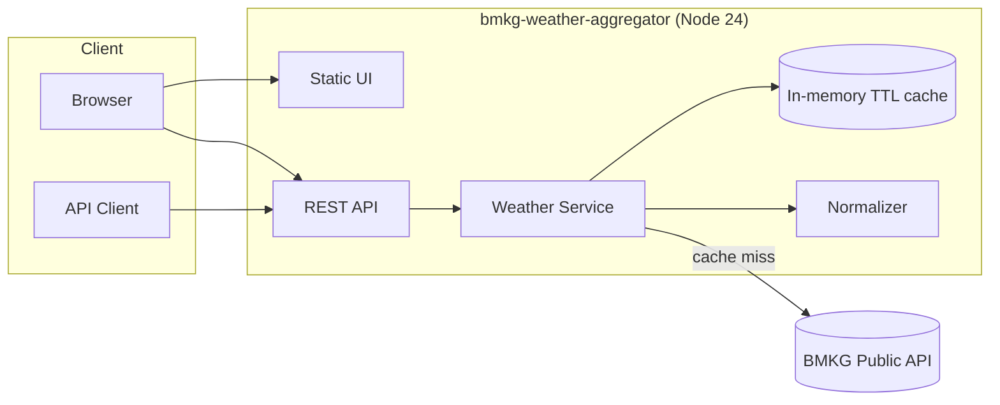
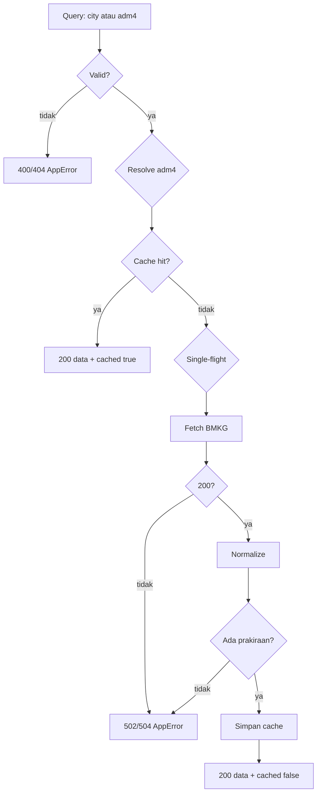
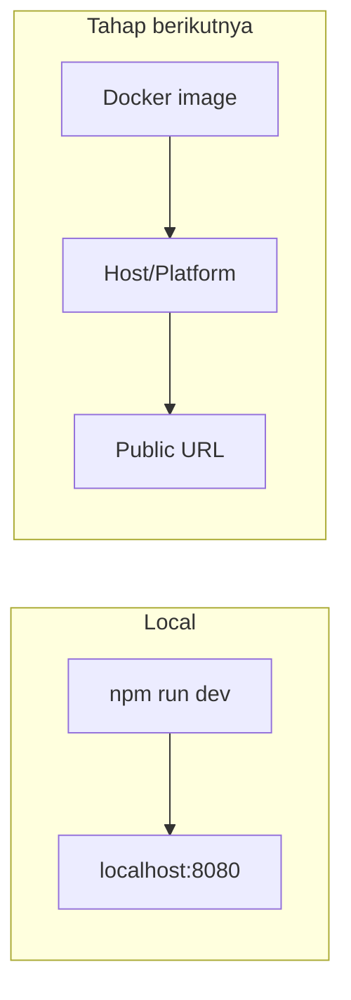

# Architecture — BMKG Weather Aggregator

## 1. Ringkasan

Satu proses Node.js menjalankan dua hal: REST API dan penyajian file statis untuk UI. Tidak ada database pada v1. Data cuaca diambil dari API publik BMKG saat cache kosong, dinormalisasi, lalu disimpan sementara di memori.



## 2. Konteks sistem

| Aktor/Sistem | Hubungan |
|---|---|
| Pengunjung | Membuka UI, memilih kota, melihat prakiraan |
| Klien API | Memanggil `/api/cities` dan `/api/weather` |
| BMKG API | Sumber data prakiraan; hanya dipanggil saat cache miss |
| GitHub Actions | Menjalankan lint, typecheck, test, build |
| Operator | Menjalankan proses, memantau log dan `/health` |

## 3. Komponen

| Komponen | Tanggung jawab | Teknologi |
|---|---|---|
| HTTP server | Routing, validasi, error mapping, static files | Fastify 5 |
| Static UI | Halaman pemilih kota dan kartu prakiraan | HTML, CSS, JS tanpa build |
| Weather service | Orkestrasi cache, single-flight, normalisasi | TypeScript |
| BMKG client | HTTP, timeout, retry, parsing | `fetch` bawaan Node |
| Cache | TTL in-memory, key per `adm4` | `Map` |
| Normalizer | Transformasi model mentah ke model internal | TypeScript murni |
| City catalog | Allowlist 15 kota terverifikasi | Data statis |
| Config | Validasi environment saat boot | zod |
| Logger | Log terstruktur, request id | pino |

Detail antarmuka: [`docs/architecture/modules.md`](modules.md).

## 4. Alur data



## 5. Stack dan alasan

| Lapisan | Pilihan | Versi | Alasan |
|---|---|---|---|
| Runtime | Node.js LTS | 24.x | Dukungan jangka panjang, `fetch` bawaan, performa baik |
| Bahasa | TypeScript | 5.9.3 | Type safety; 5.9 dipilih karena `typescript-eslint@8` belum mendukung TS 7 |
| Framework | Fastify | 5.12.7 | Ringan, cepat, schema-first, ekosistem plugin matang |
| Validasi | zod | 4.6.7 | Validasi env dan query, tipe diturunkan dari schema |
| Static UI | @fastify/static | 10.1.7 | Menyajikan UI tanpa server terpisah |
| CORS | @fastify/cors | 11.3.1 | Memungkinkan konsumsi API dari domain lain |
| Logging | pino (bawaan Fastify) + pino-pretty | 13.x | Log JSON cepat, pretty di dev |
| Test | Vitest | 5.0.5 | Cepat, ESM native, API mirip Jest |
| Lint | ESLint + typescript-eslint | 10.13 / 8.72 | Aturan TS dan JS konsisten |
| Format | Prettier | 3.9.10 | Formatting tanpa debat |
| CI | GitHub Actions | — | Sudah tersedia di template |

Catatan versi: TypeScript dan pustaka lain tidak punya jalur "LTS". Yang dijanjikan adalah versi stabil terbaru yang kompatibel satu sama lain. Node memakai LTS (24). Lihat ADR-0002.

## 6. Keputusan arsitektur

| ADR | Keputusan |
|---|---|
| [ADR-0001](adr/0001-record-architecture-decisions.md) | Mencatat keputusan arsitektur |
| [ADR-0002](adr/0002-use-fastify-and-typescript.md) | Fastify + TypeScript |
| [ADR-0003](adr/0003-in-memory-cache-and-single-flight.md) | Cache in-memory + single-flight untuk v1 |
| [ADR-0004](adr/0004-vanilla-static-ui.md) | UI statis tanpa framework |
| [ADR-0005](adr/0005-curated-adm4-catalog.md) | Katalog `adm4` terkurasi |

## 7. Atribut kualitas

| Atribut | Cara dipenuhi |
|---|---|
| Kinerja | Cache TTL, single-flight, respons kecil, tanpa DB |
| Keandalan | Timeout, retry terbatas, error envelope, health check |
| Keamanan | Tanpa secret, tanpa PII, validasi input, secret scanning |
| Keterujian | IO diinjeksi, normalizer murni, `fastify.inject` |
| Keterbacaan | Modul kecil, satu arah dependensi, dokumentasi |
| Operabilitas | Log JSON, request id, graceful shutdown, `/health` |
| Portabilitas | Node 24, tanpa dependensi native, siap Docker |

## 8. Deployment (v1)



v1 dijalankan lokal. Dockerfile dan Compose direncanakan setelah kode stabil. Saat ditambahkan, image harus:

- memakai `node:24-alpine` pada stage runtime;
- menjalankan proses sebagai user non-root;
- hanya membawa `dist/`, `public/`, dan `node_modules` produksi;
- mendukung `HEALTHCHECK` ke `/health`.

## 9. Struktur folder target

```
.
  src/
    app.ts
    server.ts
    config.ts
    errors.ts
    logger.ts
    cache/
    clients/
    data/
    routes/
    schemas/
    services/
  public/
  tests/
    unit/
    integration/
    fixtures/
  docs/
  .github/
  package.json
  tsconfig.json
  eslint.config.js
  .prettierrc.json
  .nvmrc
  .env.example
```

## 10. Batasan yang disengaja

- Tanpa database: menghindari kompleksitas operasional pada v1.
- Tanpa Redis: cache in-memory cukup untuk satu instance.
- Tanpa autentikasi: data publik; rate limiting ditunda.
- Tanpa framework UI: fokus portofolio pada backend dan desain API.
- Tanpa import data historis: bukan tujuan v1.

## 11. Risiko arsitektur

| Risiko | Mitigasi |
|---|---|
| Cache hilang saat restart | Dapat diterima; data diambil ulang dari BMKG |
| Cache tidak konsisten antar instance | v1 single instance; Redis saat scale-out |
| Ketergantungan pada satu API | Error terstruktur + cache; adapter client terisolasi |
| Perubahan skema BMKG | Schema zod toleran + fixture test |
