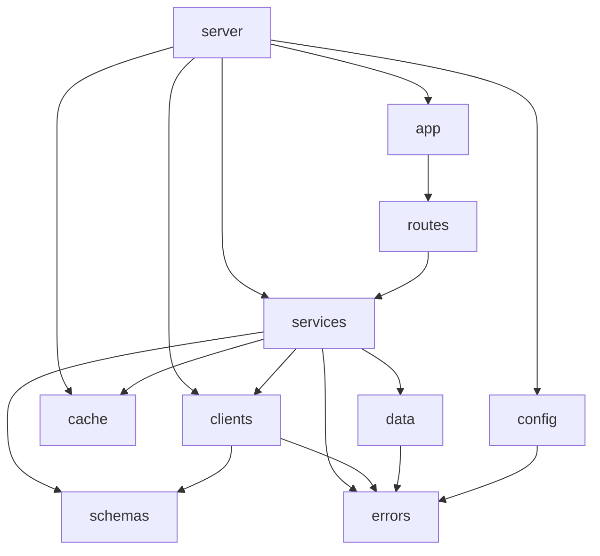

# Modules — BMKG Weather Aggregator

Dokumen ini menjelaskan pembagian modul, tanggung jawab, antarmuka, dan aturan dependensi. Tujuannya agar setiap file punya satu alasan untuk berubah dan bisa diuji terpisah.

## 1. Prinsip

- **Satu arah dependensi:** route -> service -> client/cache/data. Tidak ada modul tingkat bawah yang mengimpor route.
- **Kontrak eksplisit:** setiap modul mengekspor fungsi atau antarmuka, bukan state global.
- **IO di tepi:** akses jaringan dan waktu berada di `clients` dan `cache`; logika normalisasi murni dan mudah diuji.
- **Tidak ada import melingkar.**
- **Konfigurasi diinjeksi:** modul menerima dependensi lewat parameter, bukan membaca `process.env` sendiri (kecuali `config.ts`).

## 2. Peta modul

```
src/
  server.ts                  entrypoint proses
  app.ts                     buildApp(deps): FastifyInstance
  config.ts                  loadConfig(env): AppConfig
  routes/
    health.ts                GET /health
    cities.ts                GET /api/cities
    weather.ts               GET /api/weather
    index.ts                 registerRoutes(app, deps)
  services/
    weather.service.ts       orkestrasi lookup + cache + client + normalisasi
  clients/
    bmkg.client.ts           fetch + timeout + retry
  cache/
    cache.ts                 interface Cache
    ttl-cache.ts             implementasi Map + TTL
    single-flight.ts         deduplikasi request paralel
  data/
    cities.ts                katalog adm4 terverifikasi
  schemas/
    bmkg.ts                  schema zod respons mentah
    weather.ts               tipe model internal + schema
  errors.ts                  AppError + kode error
  logger.ts                  opsi logger pino
public/
  index.html
  styles.css
  app.js
tests/
  unit/
  integration/
  fixtures/
```

## 3. Tanggung jawab per modul

### 3.1 `config.ts`

- Membaca `process.env` sekali saat boot.
- Memvalidasi tipe dan rentang dengan zod.
- Mengembalikan objek beku `AppConfig`.
- Tidak melakukan IO lain.

```ts
export interface AppConfig {
  nodeEnv: 'development' | 'test' | 'production';
  host: string;
  port: number;
  logLevel: 'fatal' | 'error' | 'warn' | 'info' | 'debug' | 'trace';
  bmkgBaseUrl: string;
  bmkgTimeoutMs: number;
  bmkgRetry: number;
  cacheTtlSeconds: number;
}

export function loadConfig(env: NodeJS.ProcessEnv): AppConfig;
```

Aturan: nilai tidak valid melempar `ConfigError` saat boot.

### 3.2 `cache/cache.ts`

Antarmuka minimal, sengaja async agar bisa diganti Redis tanpa mengubah service.

```ts
export interface Cache {
  get<T>(key: string): Promise<T | undefined>;
  set<T>(key: string, value: T, ttlMs: number): Promise<void>;
  delete(key: string): Promise<void>;
}
```

### 3.3 `cache/ttl-cache.ts`

- Implementasi `Cache` memakai `Map<string, { value: unknown; expiresAt: number }>`.
- `get` menghapus entri kedaluwarsa saat diakses.
- Menerima `now: () => number` agar bisa diuji dengan fake timer.
- Tidak menyimpan referensi yang bisa dimutasi pemanggil (simpan nilai apa adanya; pemanggil tidak boleh memutasi hasil).
- Menyediakan `size()` untuk observability/test.

```ts
export interface TtlCacheOptions {
  now?: () => number;
  maxEntries?: number;
}

export class TtlCache implements Cache {
  constructor(options?: TtlCacheOptions);
  get<T>(key: string): Promise<T | undefined>;
  set<T>(key: string, value: T, ttlMs: number): Promise<void>;
  delete(key: string): Promise<void>;
  size(): number;
}
```

`maxEntries` default 500; saat penuh, entri kedaluwarsa dibersihkan lebih dulu, lalu entri tertua dihapus.

### 3.4 `cache/single-flight.ts`

- Menggabungkan pemanggilan bersamaan untuk key yang sama.
- Tidak menyimpan hasil; hanya berbagi promise yang sedang berjalan.

```ts
export interface SingleFlight {
  run<T>(key: string, fn: () => Promise<T>): Promise<T>;
}
```

Aturan: jika `fn` reject, semua penunggu menerima reject yang sama; key dihapus setelah selesai (sukses atau gagal).

### 3.5 `clients/bmkg.client.ts`

- Satu-satunya modul yang tahu URL dan bentuk HTTP BMKG.
- Menerapkan timeout dengan `AbortController`.
- Menerapkan retry sesuai `business-rules` BR-19.
- Memvalidasi body dengan schema zod `bmkg.ts`.
- Melempar `UpstreamError` atau `UpstreamTimeoutError`.

```ts
export interface BmkgClient {
  fetchForecast(adm4: string): Promise<BmkgRawResponse>;
}

export interface BmkgClientDeps {
  baseUrl: string;
  timeoutMs: number;
  retry: number;
  fetchFn?: typeof fetch;
  sleep?: (ms: number) => Promise<void>;
  logger?: Logger;
}

export function createBmkgClient(deps: BmkgClientDeps): BmkgClient;
```

### 3.6 `data/cities.ts`

- Sumber kebenaran katalog kota.
- Data murni, tanpa IO.
- Diekspor sebagai array `readonly City[]` yang sudah dibekukan.

```ts
export interface City {
  slug: string;
  name: string;
  province: string;
  city: string;
  district: string;
  adm4: string;
}

export const CITIES: readonly City[];
export function listCities(): readonly City[];
export function findCityBySlug(slug: string): City | undefined;
export function findCityByAdm4(adm4: string): City | undefined;
```

### 3.7 `schemas/bmkg.ts`

- Schema zod untuk respons mentah.
- Field yang tidak dipakai tetap dideklarasikan `optional`/`nullable` agar perubahan kecil BMKG tidak langsung mematahkan parsing.
- Menyediakan tipe `BmkgRawResponse`.

### 3.8 `schemas/weather.ts`

- Tipe model internal: `Location`, `Forecast`, `WeatherResult`.
- Fungsi murni `normalizeForecast(raw: BmkgRawResponse): WeatherResult`.
- Tidak melakukan IO.

```ts
export interface Location {
  adm4: string;
  province: string;
  city: string;
  district: string;
  village: string;
  latitude: number;
  longitude: number;
  timezone: string;
}

export interface Forecast {
  datetimeUtc: string;
  datetimeLocal: string;
  temperatureC: number;
  humidityPct: number | null;
  precipitationMm: number | null;
  cloudCoverPct: number | null;
  weatherId: number | null;
  descriptionId: string | null;
  descriptionEn: string | null;
  windSpeedKmh: number | null;
  windDirection: string | null;
  windDirectionTo: string | null;
  windDegree: number | null;
  iconUrl: string | null;
}

export interface WeatherResult {
  location: Location;
  forecasts: Forecast[];
}
```

### 3.9 `services/weather.service.ts`

Satu-satunya orkestrator. Bertanggung jawab atas urutan:

1. Resolve input menjadi `adm4`.
2. Cek cache.
3. Jika miss, jalankan single-flight -> `bmkgClient.fetchForecast`.
4. Normalisasi.
5. Simpan ke cache.
6. Kembalikan `WeatherResult` + metadata cache.

```ts
export interface WeatherServiceDeps {
  cache: Cache;
  singleFlight: SingleFlight;
  bmkgClient: BmkgClient;
  ttlMs: number;
  now?: () => Date;
  logger?: Logger;
}

export interface WeatherLookup {
  city?: string;
  adm4?: string;
}

export interface WeatherServiceResult {
  result: WeatherResult;
  cached: boolean;
  fetchedAt: string;
}

export function createWeatherService(deps: WeatherServiceDeps): {
  getWeather(lookup: WeatherLookup): Promise<WeatherServiceResult>;
};

export type WeatherService = ReturnType<typeof createWeatherService>;
```

Service tidak boleh mengembalikan error mentah dari `fetch`; semua error dinormalisasi ke `AppError`.

### 3.10 `routes/*`

- Hanya menangani HTTP: parsing query, validasi, pemanggilan service, pemetaan ke status code.
- Tidak berisi logika bisnis atau akses jaringan langsung.
- Menggunakan `reply.code(...).send(...)`.

```ts
export interface RouteDeps {
  weatherService: ReturnType<typeof createWeatherService>;
}
```

### 3.11 `app.ts`

- Membuat instance Fastify.
- Mendaftarkan `@fastify/cors`, `@fastify/static`, logger, error handler, dan route.
- Menerima dependensi dari luar agar test bisa memakai mock.

```ts
export interface BuildAppDeps {
  config: AppConfig;
  weatherService: WeatherService;
  logger?: boolean | LoggerOptions;
}

export function buildApp(deps: BuildAppDeps): FastifyInstance;
```

### 3.12 `server.ts`

- Memuat config.
- Merakit dependency nyata (`TtlCache`, `SingleFlight`, `createBmkgClient`, `createWeatherService`).
- Memanggil `buildApp`, `listen`, dan memasang graceful shutdown.
- Satu-satunya file yang menyentuh `process` untuk lifecycle.

## 4. Aturan dependensi



Larangan:

- `routes` tidak boleh mengimpor `clients` atau `node:fs`.
- `schemas` tidak boleh mengimpor `services`, `routes`, atau `clients`.
- `data` tidak boleh melakukan IO.
- Tidak ada modul yang memanggil `fetch` selain `clients/bmkg.client.ts`.

## 5. Penanganan error

```ts
export type ErrorCode =
  | 'INVALID_QUERY'
  | 'AMBIGUOUS_QUERY'
  | 'CITY_NOT_FOUND'
  | 'ADM4_NOT_FOUND'
  | 'UPSTREAM_ERROR'
  | 'UPSTREAM_TIMEOUT'
  | 'INTERNAL_ERROR';

export class AppError extends Error {
  constructor(
    public readonly code: ErrorCode,
    message: string,
    public readonly statusCode: number,
    public readonly cause?: unknown,
  );
}

export class UpstreamTimeoutError extends AppError;
```

Aturan:

- Modul bawah melempar `AppError` dengan kode yang tepat.
- Error handler di `app.ts` memetakan `AppError` ke envelope error.
- Error tak dikenal menjadi `500 INTERNAL_ERROR` dan dicatat lengkap di log.

## 6. Injeksi dependensi

Semua modul yang bergantung pada waktu, jaringan, atau cache menerima dependensi lewat parameter. Ini yang membuat test tidak memerlukan jaringan atau tidur nyata.

| Modul | Dependensi yang diinjeksi |
|---|---|
| `TtlCache` | `now`, `maxEntries` |
| `createBmkgClient` | `fetchFn`, `sleep`, `logger` |
| `createWeatherService` | `cache`, `singleFlight`, `bmkgClient`, `now`, `logger` |
| `buildApp` | `config`, `weatherService`, `logger` |

## 7. Mapping file ke dokumen

| Kebutuhan | Dokumen |
|---|---|
| Perilaku & aturan | `docs/product/business-rules.md` |
| Alur request | `docs/architecture/workflows.md` |
| Kontrak HTTP | `docs/architecture/api-spec.md` |
| Bentuk data | `docs/architecture/data-model.md` |
| Keputusan teknis | `docs/architecture/adr/` |
| Cara uji | `docs/analysis/testing-strategy.md` |
