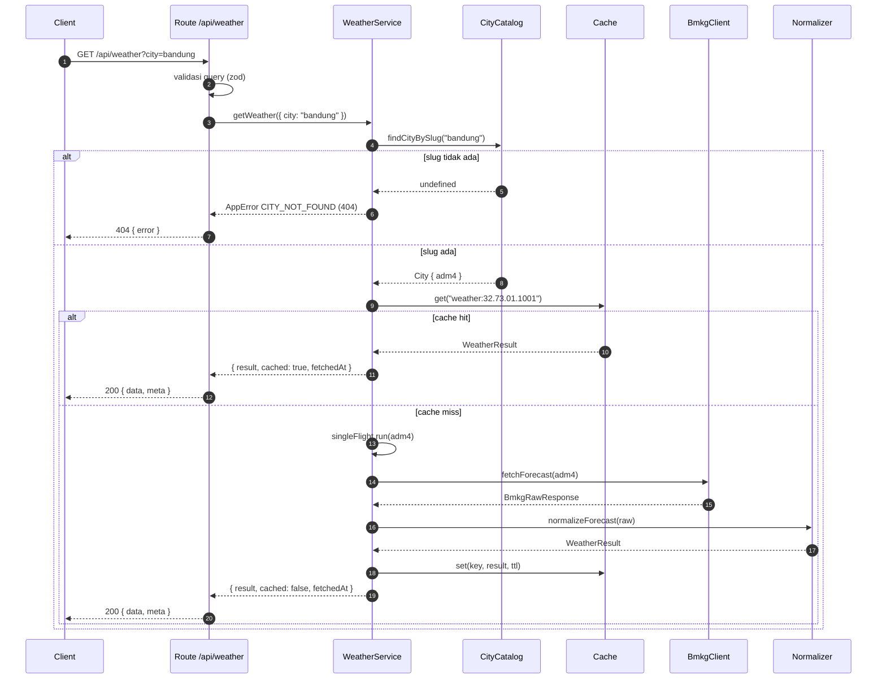
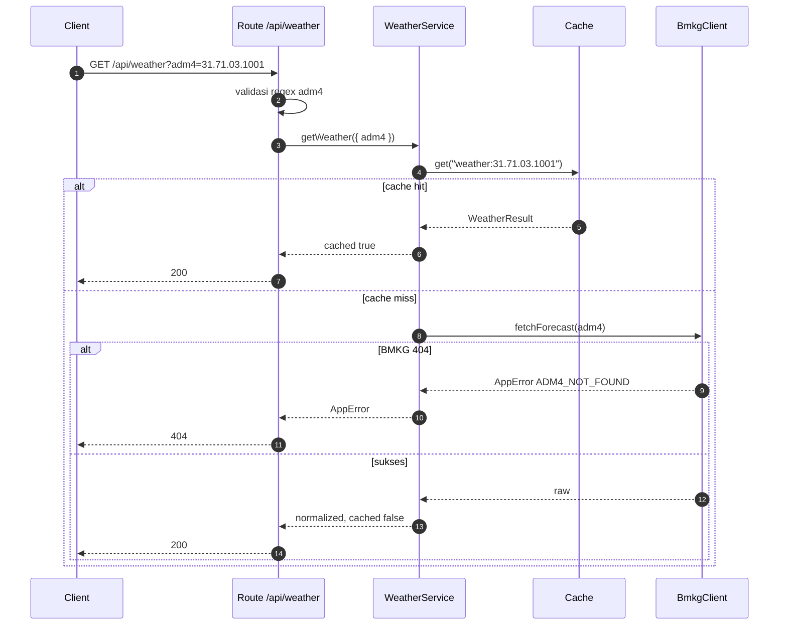
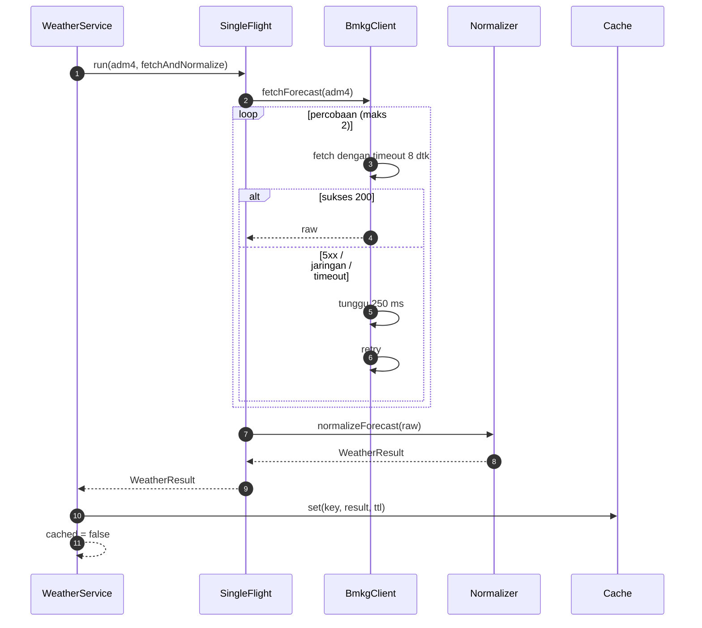
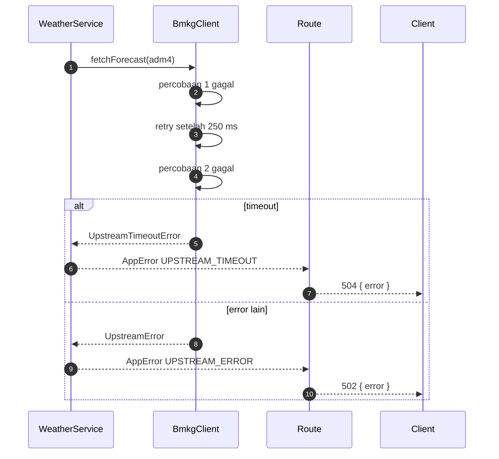
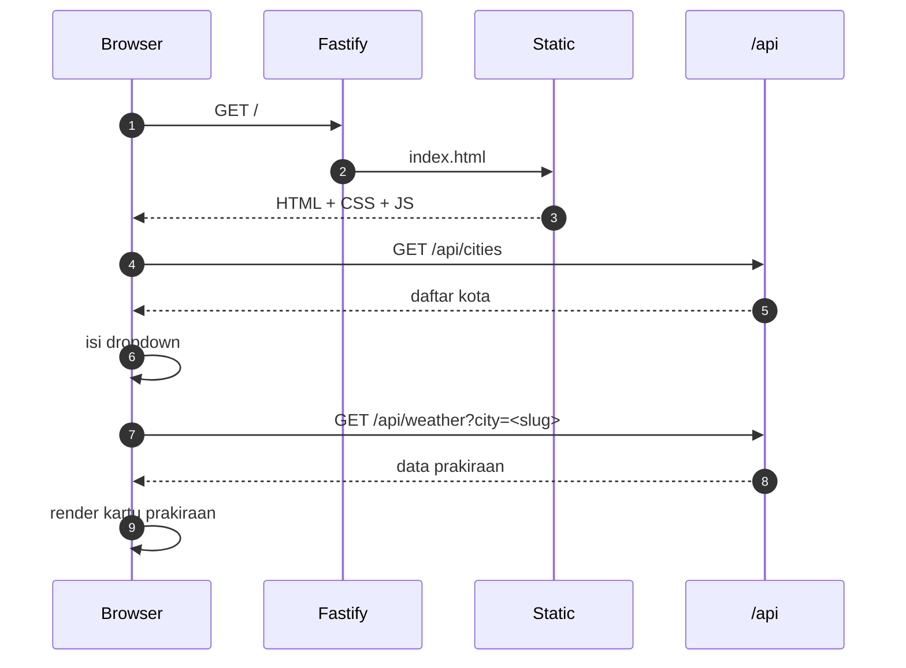
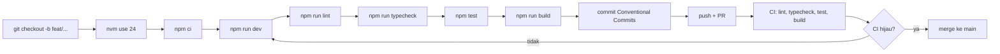

# Workflows — BMKG Weather Aggregator

Dokumen ini menjelaskan alur runtime dan alur kerja pengembangan. Setiap alur memetakan ke modul di `docs/architecture/modules.md` dan aturan di `docs/product/business-rules.md`.

## 1. Daftar alur

| ID | Alur | Aktor |
|---|---|---|
| WF-01 | Request cuaca berdasarkan slug kota | Klien API / web |
| WF-02 | Request cuaca berdasarkan `adm4` | Klien API |
| WF-03 | Cache hit | Sistem |
| WF-04 | Cache miss + upstream sukses | Sistem |
| WF-05 | Cache miss + upstream gagal/timeout | Sistem |
| WF-06 | Validasi query gagal | Sistem |
| WF-07 | Memuat halaman web | Pengunjung |
| WF-08 | Alur pengembangan & CI | Developer |

## 2. WF-01 — Request berdasarkan slug kota



Langkah:

1. Route memvalidasi query. Jika gagal, langsung WF-06.
2. Service mencari slug di katalog. Tidak ditemukan -> `404 CITY_NOT_FOUND`.
3. Service memakai `adm4` dari katalog sebagai key cache.
4. Jika cache hit, lanjut WF-03. Jika miss, lanjut WF-04 atau WF-05.

## 3. WF-02 — Request berdasarkan `adm4`



Catatan: `?adm4=` tidak harus ada di katalog. Katalog hanya dipakai untuk `?city=` dan daftar kota.

## 4. WF-03 — Cache hit

1. `cache.get(key)` mengembalikan entri yang belum kedaluwarsa.
2. Service tidak memanggil BMKG.
3. `cached = true`, `fetchedAt` dari entri cache.
4. Route mengirim `200` dengan `Cache-Control: public, max-age=300`.

## 5. WF-04 — Cache miss + upstream sukses



Aturan:

- Hanya hasil sukses yang disimpan.
- Normalisasi yang menghasilkan nol prakiraan dianggap gagal (`UPSTREAM_ERROR`).
- Request lain untuk key yang sama menunggu promise yang sama.

## 6. WF-05 — Upstream gagal atau timeout



- Tidak ada cache negatif.
- Tidak ada data parsial yang dikirim.
- Log memuat `adm4`, `attempt`, `duration_ms`, dan `request_id`.
- Klien hanya menerima pesan umum, tanpa detail internal.

## 7. WF-06 — Validasi query gagal

| Input | Status | Kode |
|---|---|---|
| Tidak ada `city`/`adm4` | 400 | `INVALID_QUERY` |
| Keduanya ada | 400 | `AMBIGUOUS_QUERY` |
| `adm4` format salah | 400 | `INVALID_QUERY` |
| `city` kosong atau > 64 karakter | 400 | `INVALID_QUERY` |
| `city` tidak ada di katalog | 404 | `CITY_NOT_FOUND` |

Validasi dilakukan di route sebelum service dipanggil. Tidak ada panggilan BMKG untuk request tidak valid.

## 8. WF-07 — Memuat halaman web



Perilaku UI:

- Saat memuat: tampilkan status loading.
- Saat error: tampilkan pesan dari `error.message` dan `requestId`.
- Menampilkan label "Sumber: BMKG" dan disclaimer.
- Tidak ada framework frontend dan tidak ada build step; file statis disajikan langsung.

## 9. WF-08 — Alur pengembangan dan CI



Langkah lokal:

```bash
nvm use 24
npm ci
cp .env.example .env
npm run dev
```

Definisi PR siap merge:

- Commits mengikuti Conventional Commits.
- Lint, typecheck, test, build lulus.
- Test baru untuk perilaku baru.
- Dokumentasi terkait diperbarui jika perilaku berubah.
- Tidak ada secret atau data pribadi.

## 10. Alur rilis (setelah v1 stabil)

1. Perbarui `docs/changelog/CHANGELOG.md` di bagian `[Unreleased]`.
2. Tentukan versi SemVer.
3. Pindahkan catatan ke heading versi dan tanggal.
4. Commit `chore(release): vX.Y.Z`.
5. Tag `vX.Y.Z` dan push tag.
6. Docker workflow (saat diaktifkan) membangun dan mempublikasikan image.
